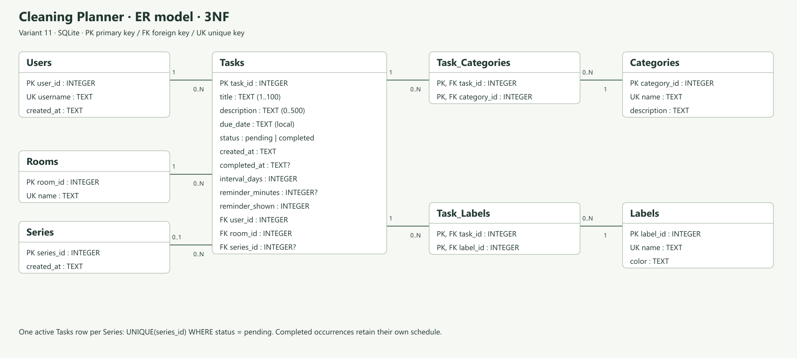

# Проектирование базы данных «Планировщик уборки»

**Лабораторная работа №4**

**Проект:** «Планировщик уборки»  
**Студентка:** Жалилова Дарья Ренатовна  
**Вариант:** 11  
**Репозиторий:** [darazalilova-cpu/cleaning-planner-srs](https://github.com/darazalilova-cpu/cleaning-planner-srs)

**База данных:** SQLite.

Цель работы — подготовить базу для хранения домашних дел и привести её к третьей нормальной форме (3НФ).

## 1. Что хранится в базе

Пользователь создаёт дело, выбирает комнату и срок. Дело может повторяться. После выполнения запись остаётся в истории.

Подготовлены таблицы:

- `Users` — пользователь.
- `Rooms` — комнаты.
- `Tasks` — дела.
- `Series` — группы повторяющихся дел.
- `Categories` — категории дел.
- `Labels` — метки.
- `Task_Categories` — связь дел с категориями.
- `Task_Labels` — связь дел с метками.

## 2. Исходный вариант хранения

Сначала все сведения можно представить одной записью:

```text
Дело, название, срок, статус, пользователь, комната,
категории, метки, повторение, напоминание, время выполнения
```

При таком хранении названия комнат и данные пользователя повторяются. Категории и метки могут оказаться списком в одной ячейке.

Это неудобно: при переименовании комнаты придётся менять несколько записей. При удалении последнего дела можно потерять сведения о комнате.

## 3. Первая нормальная форма — 1НФ

В каждой ячейке должно быть одно значение.

Списки категорий и меток разделяются на отдельные строки. В промежуточном варианте строку определяет сочетание номера дела, категории и метки.

Например, две категории дела хранятся двумя связями, а не строкой через запятую.

## 4. Вторая нормальная форма — 2НФ

Данные должны относиться ко всему ключу строки.

В промежуточной записи название дела зависит только от номера дела, название категории — от номера категории, а название метки — от номера метки.

Поэтому данные дел, категорий и меток разделены. Для их связей созданы `Task_Categories` и `Task_Labels`. В них хранятся только пары номеров.

## 5. Третья нормальная форма — 3НФ

Сведения о пользователе и комнате хранятся отдельно от дела.

В `Tasks` остаются номера пользователя и комнаты. Имя пользователя хранится в `Users`, название комнаты — в `Rooms`.

Категории и метки также имеют свои таблицы. Поэтому их названия достаточно изменить в одном месте.

У выполненного дела сохраняются прежние срок, повторение и настройка напоминания. Изменение нового дела не меняет историю.

## 6. Схема и связи



- У пользователя может быть много дел.
- В одной комнате может быть много дел.
- Одна группа повторений объединяет несколько дел.
- У дела может быть несколько категорий и меток.
- Одна категория или метка может относиться к нескольким делам.

Последние две связи реализованы через `Task_Categories` и `Task_Labels`.

[PNG](https://github.com/darazalilova-cpu/cleaning-planner-srs/blob/main/docs/database/er_diagram.png) · [SVG](https://github.com/darazalilova-cpu/cleaning-planner-srs/blob/main/docs/database/er_diagram.svg) · [Исходник диаграммы](https://github.com/darazalilova-cpu/cleaning-planner-srs/blob/main/docs/database/er_diagram.puml)

## 7. Основные поля

- `Users`: номер и имя пользователя, дата создания.
- `Rooms`: номер и название комнаты.
- `Tasks`: номер, название, описание, срок, статус, время выполнения, повторение и напоминание.
- `Series`: номер группы повторений и дата создания.
- `Categories`: номер, название и описание категории.
- `Labels`: номер, название и цвет метки.
- `Task_Categories`: номер дела и номер категории.
- `Task_Labels`: номер дела и номер метки.

У каждой основной записи есть свой уникальный номер. Связи с другими таблицами проверяются базой.

## 8. Создание базы в SQLite

[Скрипт создания базы](https://github.com/darazalilova-cpu/cleaning-planner-srs/blob/main/database/schema.sql)

[Тестовые данные](https://github.com/darazalilova-cpu/cleaning-planner-srs/blob/main/database/seed_data.sql)

В схеме заданы обязательные поля, допустимые статусы, ограничения длины текста и повторений. Индексы помогают выбирать дела по пользователю, комнате, сроку и статусу.

Для одной группы повторений допускается только одно невыполненное дело.

## 9. Проверка

1. Создайте пустую базу SQLite.
2. Выполните `schema.sql`.
3. Один раз выполните `seed_data.sql`.
4. Проверьте данные и связи командой `PRAGMA foreign_key_check;`. Результат должен быть пустым.

В тестовых данных есть один пользователь, шесть комнат, две категории, две метки, одна группа повторений и четыре дела.

Для автоматической проверки выполните:

```sh
python tests/test_database.py
```

Проверяются создание таблиц, тестовые данные, связи, ограничения и индексы. Подготовлено 5 тестов.

## 10. Итог

Подготовлена база SQLite из восьми таблиц и схема связей. Данные разделены до 3НФ, добавлены ограничения, индексы и примеры записей.

Браузерное приложение из работы №3 сохраняет дела в `localStorage`. Схема SQLite — результат работы №4.
