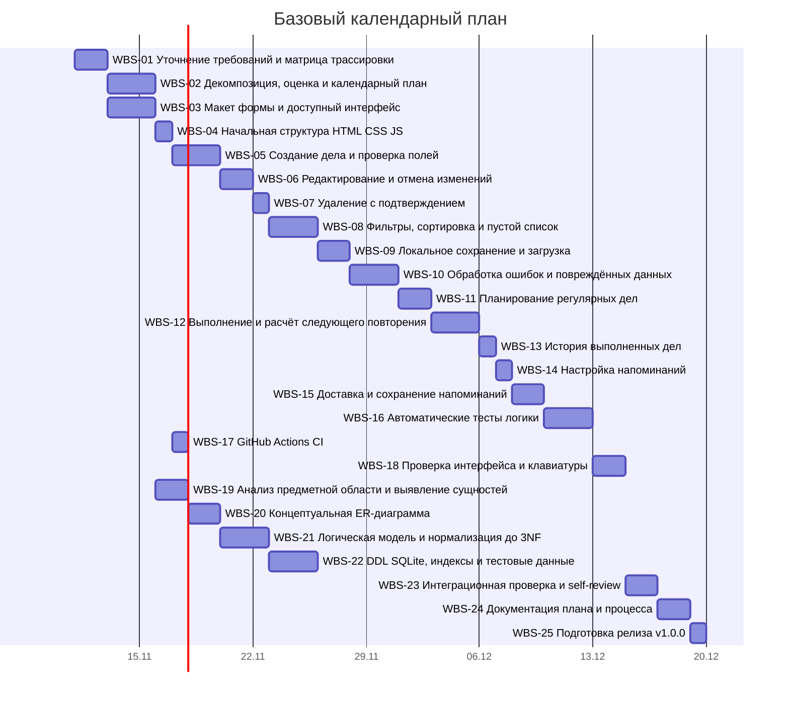

# План проекта Планировщик уборки

Лабораторная №2, вариант 11. Беклог: 25 детализированных задач (#7–#31); исходные #1–#6 остаются высокоуровневыми требованиями первой работы. Это учебный базовый план на 11.11–19.12.2026 (39 календарных дней). Фактические даты выполнения отражены в PR и коммитах; плановые даты сохранены для демонстрации планирования.

## Участники и роли

Работа индивидуальная: все задачи назначены @darazalilova-cpu. ФИО не добавлено, поскольку оно не предоставлено. Backend в локальном прототипе означает логику данных, отдельного сервера нет.

| Роль | Участник | Обязанности |
|---|---|---|
| Project Manager | @darazalilova-cpu | Планирование, сроки, приёмка и документация |
| Frontend | @darazalilova-cpu | HTML, CSS, формы и фильтры |
| Backend | @darazalilova-cpu | Прикладная логика, хранение, SQLite |
| QA | @darazalilova-cpu | Автоматические и ручные проверки |
| Дизайнер | @darazalilova-cpu | Макет, состояния формы и доступность |

## Контрольные точки

| Этап | Срок | Результат |
|---|---|---|
| M1 Подготовка и настройка | 16.11.2026 | Требования, макет и структура |
| M2 Базовый функционал и БД | 30.11.2026 | CRUD, хранилище, 3NF и SQL |
| M3 Организация и качество | 14.12.2026 | Повторения, напоминания, фильтры и тесты |
| M4 Финальное тестирование и релиз | 19.12.2026 | Проверка, документация и v1.0.0 |

## Беклог и оценки

Всего 25 задач, 159 человеко-часов. Сложность: small — 9, medium — 13, large — 3. Оценка в часах отражает трудоёмкость, а диапазон дат — календарное окно. Резерв и параллельные окна отражают переключение ролей одного исполнителя.

| WBS / Issue | Задача | Роль | Часы | Сложность | Начало | Конец | Зависимости |
|---|---|---|---:|---|---|---|---|
| [01 / #7](https://github.com/darazalilova-cpu/cleaning-planner-srs/issues/7) | Уточнение требований и матрица трассировки | Project Manager | 6 | small | 2026-11-11 | 2026-11-12 | Нет |
| [02 / #8](https://github.com/darazalilova-cpu/cleaning-planner-srs/issues/8) | Декомпозиция, оценка и календарный план | Project Manager | 9 | medium | 2026-11-13 | 2026-11-15 | #7 |
| [03 / #9](https://github.com/darazalilova-cpu/cleaning-planner-srs/issues/9) | Макет формы и доступный интерфейс | Дизайнер | 9 | medium | 2026-11-13 | 2026-11-15 | #7 |
| [04 / #10](https://github.com/darazalilova-cpu/cleaning-planner-srs/issues/10) | Начальная структура HTML CSS JS | Frontend | 3 | small | 2026-11-16 | 2026-11-16 | #9 |
| [05 / #11](https://github.com/darazalilova-cpu/cleaning-planner-srs/issues/11) | Создание дела и проверка полей | Frontend | 9 | medium | 2026-11-17 | 2026-11-19 | #10 |
| [06 / #12](https://github.com/darazalilova-cpu/cleaning-planner-srs/issues/12) | Редактирование и отмена изменений | Frontend | 6 | medium | 2026-11-20 | 2026-11-21 | #11 |
| [07 / #13](https://github.com/darazalilova-cpu/cleaning-planner-srs/issues/13) | Удаление с подтверждением | Frontend | 3 | small | 2026-11-22 | 2026-11-22 | #11 |
| [08 / #14](https://github.com/darazalilova-cpu/cleaning-planner-srs/issues/14) | Фильтры, сортировка и пустой список | Frontend | 9 | medium | 2026-11-23 | 2026-11-25 | #11 |
| [09 / #15](https://github.com/darazalilova-cpu/cleaning-planner-srs/issues/15) | Локальное сохранение и загрузка | Backend | 6 | medium | 2026-11-26 | 2026-11-27 | #11 |
| [10 / #16](https://github.com/darazalilova-cpu/cleaning-planner-srs/issues/16) | Обработка ошибок и повреждённых данных | Backend | 9 | large | 2026-11-28 | 2026-11-30 | #15 |
| [11 / #17](https://github.com/darazalilova-cpu/cleaning-planner-srs/issues/17) | Планирование регулярных дел | Backend | 6 | medium | 2026-12-01 | 2026-12-02 | #11 |
| [12 / #18](https://github.com/darazalilova-cpu/cleaning-planner-srs/issues/18) | Выполнение и расчёт следующего повторения | Backend | 9 | large | 2026-12-03 | 2026-12-05 | #17, #15 |
| [13 / #19](https://github.com/darazalilova-cpu/cleaning-planner-srs/issues/19) | История выполненных дел | Frontend | 3 | small | 2026-12-06 | 2026-12-06 | #18 |
| [14 / #20](https://github.com/darazalilova-cpu/cleaning-planner-srs/issues/20) | Настройка напоминаний | Frontend | 3 | small | 2026-12-07 | 2026-12-07 | #11 |
| [15 / #21](https://github.com/darazalilova-cpu/cleaning-planner-srs/issues/21) | Доставка и сохранение напоминаний | Backend | 6 | medium | 2026-12-08 | 2026-12-09 | #20, #15 |
| [16 / #22](https://github.com/darazalilova-cpu/cleaning-planner-srs/issues/22) | Автоматические тесты логики | QA | 9 | medium | 2026-12-10 | 2026-12-12 | #16, #18, #21 |
| [17 / #23](https://github.com/darazalilova-cpu/cleaning-planner-srs/issues/23) | GitHub Actions CI | QA | 3 | small | 2026-11-17 | 2026-11-17 | #10 |
| [18 / #24](https://github.com/darazalilova-cpu/cleaning-planner-srs/issues/24) | Проверка интерфейса и клавиатуры | QA | 6 | medium | 2026-12-13 | 2026-12-14 | #14, #19, #21 |
| [19 / #25](https://github.com/darazalilova-cpu/cleaning-planner-srs/issues/25) | Анализ предметной области и выявление сущностей | Backend | 6 | small | 2026-11-16 | 2026-11-17 | #7 |
| [20 / #26](https://github.com/darazalilova-cpu/cleaning-planner-srs/issues/26) | Концептуальная ER-диаграмма | Backend | 6 | medium | 2026-11-18 | 2026-11-19 | #25 |
| [21 / #27](https://github.com/darazalilova-cpu/cleaning-planner-srs/issues/27) | Логическая модель и нормализация до 3NF | Backend | 9 | large | 2026-11-20 | 2026-11-22 | #26 |
| [22 / #28](https://github.com/darazalilova-cpu/cleaning-planner-srs/issues/28) | DDL SQLite, индексы и тестовые данные | Backend | 9 | medium | 2026-11-23 | 2026-11-25 | #27 |
| [23 / #29](https://github.com/darazalilova-cpu/cleaning-planner-srs/issues/29) | Интеграционная проверка и self-review | QA | 6 | medium | 2026-12-15 | 2026-12-16 | #22, #23, #24, #28 |
| [24 / #30](https://github.com/darazalilova-cpu/cleaning-planner-srs/issues/30) | Документация плана и процесса | Project Manager | 6 | small | 2026-12-17 | 2026-12-18 | #8, #29 |
| [25 / #31](https://github.com/darazalilova-cpu/cleaning-planner-srs/issues/31) | Подготовка релиза v1.0.0 | Project Manager | 3 | small | 2026-12-19 | 2026-12-19 | #29, #30 |

## Диаграмма Ганта

[GitHub Projects — Roadmap](https://github.com/users/darazalilova-cpu/projects/1). Зависимости указаны в Issues и столбце таблицы выше.

## Риски и контроль

Основные риски — перегрузка единственного исполнителя, потеря локальных данных и ошибки календарных повторений. В первую очередь реализуются P0: создание, хранение, надёжность, повторения и DDL. Проверки запускаются в CI, история и новый экземпляр сохраняются вместе, повреждённые данные блокируют запись до подтверждённой очистки. Напоминания ограничены открытой вкладкой.

Контроль этапа проводится по критериям Issues, тестам и self-review PR. Сдвиг задачи требует проверки всех её зависимых задач и актуализации Roadmap.
